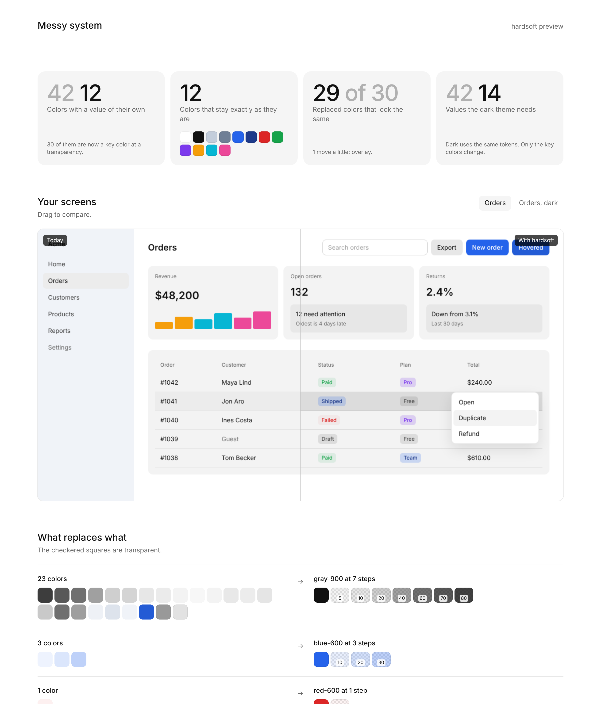

# hardsoft

**A few master colors and one transparency scale, in place of dozens of grays.**

hardsoft is a skill for coding agents. It rebuilds the colors of a design system on the hard and soft surfaces concept: hard surfaces are solid, soft surfaces are transparent. It keeps how your product looks, and changes what the colors are made from.

The concept is explained in the article [Hard and soft surfaces: a concept of a highly flexible design system](https://plyuto.design/article/soft-and-hard-surfaces).



## The problem

In most design systems the list of grays keeps growing. A card needs a gray a bit darker than the page. A card inside it needs another. Hover needs a third. Dark mode doubles all of it. Nobody remembers the whole palette, and a small change means editing dozens of values.

## The idea

1. **Masters.** A few solid colors: the grays, the brand, the system colors.
2. **One alpha scale.** Every other color is a master at a step: the ink at 5%, 10%, 20%.
3. **One question for any element: is it in the flow, or above it?**
   - In the flow (a card, a button, an input, a divider): **soft**. A transparent token over whatever is under it.
   - Above the flow (a menu, a modal, a tooltip): **hard**. A solid color, and everything inside it starts from zero again.

A card inside a card inside a card uses the same token three times, and the contrast stays right at every level.

```css
/* Before: a new color for every level and state */
--surface-card: #f3f3f3;
--surface-card-nested: #e8e8e8;
--surface-card-hover: #ececec;
--border-subtle: #e5e5e5;

/* After: the ink at a step. The old names keep working */
--gray-900-5: color-mix(in srgb, var(--gray-900) 5%, transparent);
--gray-900-10: color-mix(in srgb, var(--gray-900) 10%, transparent);
--surface-card: var(--gray-900-5);
--surface-card-nested: var(--gray-900-5);
--surface-card-hover: var(--gray-900-10);
--border-subtle: var(--gray-900-10);
```

## What it does

It has three actions.

| Action | What you get | What it changes |
| --- | --- | --- |
| **Report** | A short interview, then what your system would win, in numbers, and a preview page. | Nothing. |
| **Apply** | The report, a few questions, a plan and a preview. After your yes: the new tokens, and the report again with the real numbers. | Your tokens only. |
| **Theme** | A dark mode on top of the new tokens. Only when you ask for it. | The theme's grays. |

Start with the report. It is free to try: it changes nothing and tells you if there is anything to win. It asks you a few questions first, like which screens matter and how close the result must stay, so the report is about your product and not a guess.

## What the report shows

Numbers from the worked example, [examples/messy-system](examples/messy-system):

| | Before | After |
| --- | --- | --- |
| Independent tokens | 42 | 12 |
| Solid colors | 41 | 7 masters and 8 steps |
| Colors that only name a level or a state | 3 | 0 |
| Values to edit to change all the grays | 23 | 1 |
| Values the dark theme needs | 42 | 14 |

**Closeness: 98%.** 29 of the 30 replaced colors still look the same, and the other 12 are untouched. The one that moved is named, with how far.

The report also lists:

- every old token and the master and step it becomes, with how far the color moves
- which surfaces are hard and which are soft
- strokes, and which should become a hairline shadow
- text that fails WCAG AA, with the nearest step that passes
- colors that fit nothing, and your options for each
- components that carry their own colors
- tokens that can be removed later

## What it never does

- It never changes anything before you have seen the plan and the preview and said yes.
- It never edits your components. It changes the token layer and lists the rest.
- It never deletes or renames a token. Every old name keeps working.
- It never moves a color silently. A color that fits no master is kept, listed and asked about.
- It never adds a dark mode nobody asked for.
- It never touches gradients, photos, illustrations, charts or code highlighting.

## How it decides

The concept is written down as [30 rules](skills/hardsoft/approach.md). Each rule has a level: **strict** never breaks, **default** bends with a stated reason, **advice** is a starting point. Your project's own rules always come first.

A few of them:

| Case | Answer |
| --- | --- |
| A sticky header that content scrolls under | Hard |
| A sidebar beside the content | Soft |
| Stacked avatars, a badge on a card corner | Hard: it covers a neighbor |
| A button on a brand banner | Soft: the banner is its ground |
| A label on a photo | Hard |
| A menu with its own solid gray | Stays solid. Hard surfaces can have a few |
| A transparent border on a transparent fill | A hairline shadow, added to the element's other shadows |
| Several grays with the same blue tint | Offer to tint the ink, with the cost for the other grays |
| A brand ramp, blue 50 to 900 | One master and its tints. A darker shade in real use can become a second master |
| Hover | One more layer of ink. Other states keep your design |

## How it checks itself

- **The color math is a script, not a guess.** It finds the alpha of every color over the background it really sits on, builds both versions of the scale, measures text contrast, and counts the benchmarks. It has tests.
- **The preview is one fixed page**, the same for every project, made from your whole system: every color today next to what it becomes, light and dark side by side, and your real screens before and after with a slider.
- **Real screens.** Where the app runs, it reads two or three screens with [census](https://github.com/leonidstern/census) before and after, and measures every element that changed. This catches what a token table can't: muted text that now sits on a darker nested card, a stroke doubled over a fill.

## Install

### Claude Code

As a plugin:

```text
/plugin marketplace add plyuto-lgtm/hardsoft
/plugin install hardsoft@plyuto
```

Or copy the skill folder by hand:

```bash
git clone https://github.com/plyuto-lgtm/hardsoft.git
```

```bash
cp -r hardsoft/skills/hardsoft ~/.claude/skills/
```

### Claude.ai

Download [hardsoft.zip](https://github.com/plyuto-lgtm/hardsoft/releases/latest/download/hardsoft.zip) and upload it as a skill in Claude's settings.

### Other agents and chats

Cursor, Codex, ChatGPT and others can use it too. Ask the agent to read the skill first:

```text
Read https://raw.githubusercontent.com/plyuto-lgtm/hardsoft/main/skills/hardsoft/SKILL.md and the files it links to, then apply it to this project.
```

If the agent can't open links, give it the files from `skills/hardsoft`.

## Use

In a project, start with the report:

```text
Run a hardsoft report on this project.
```

Then, if you like what you would win:

```text
Apply hardsoft.
```

In Claude Code with the plugin, the same actions are commands: `/hardsoft:report`, `/hardsoft:apply` and `/hardsoft:theme`.

In a chat, add your tokens, a screenshot or a link, and ask the same.

It writes the tokens in the format you already have: Tailwind 4, Tailwind 3, CSS variables, Sass, JS or TS, or JSON tokens.

## What is inside

- [skills/hardsoft/SKILL.md](skills/hardsoft/SKILL.md): the instructions and the three actions.
- [skills/hardsoft/approach.md](skills/hardsoft/approach.md): the concept and its 30 rules.
- [skills/hardsoft/scripts/hardsoft.mjs](skills/hardsoft/scripts/hardsoft.mjs): the color math. Node 18 or newer, nothing to install.
- [skills/hardsoft/templates/preview.html](skills/hardsoft/templates/preview.html): the preview page.
- [skills/hardsoft/templates/report.md](skills/hardsoft/templates/report.md): the shape of the report.
- [skills/hardsoft/formats.md](skills/hardsoft/formats.md): the tokens in each format.
- [skills/hardsoft/templates/theme.css](skills/hardsoft/templates/theme.css) and [tokens.css](skills/hardsoft/templates/tokens.css): the patterns for Tailwind 4 and plain CSS variables, with no colors: yours go in.
- [commands](commands): the three commands for Claude Code.
- [examples/messy-system](examples/messy-system): a worked example, before and after, with its report and preview.
- [tests](tests): tests for the color math (`node --test`), and the cases to check after changing the instructions.
- [CHANGELOG.md](CHANGELOG.md): what changed in each version.

## Licence

[MIT](LICENSE): use it, change it and share it freely.

By [Alexander Plyuto](https://plyuto.design).
